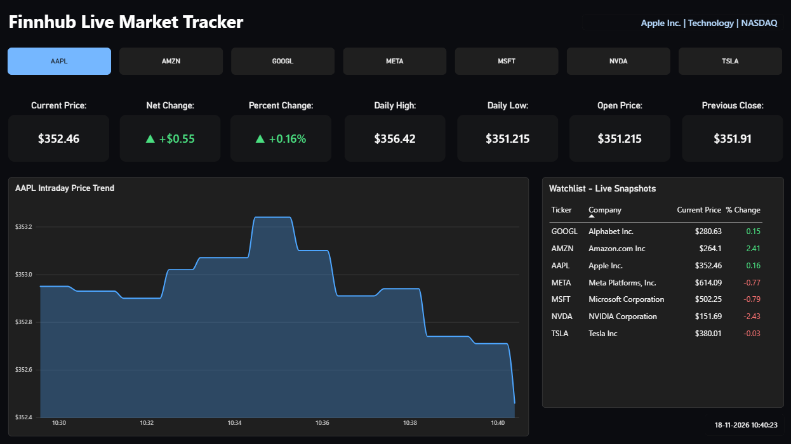

# 📈 Finnhub Live Market Tracker

An end-to-end Data Engineering and Business Intelligence pipeline that ingests real-time stock market quotes every 10 seconds using Python, stores them in a dual-table PostgreSQL database, and visualizes live KPIs and intraday price trends in Power BI.



---

## 📌 Overview

Static market exports make it difficult to monitor rapid intraday swings across multiple equities simultaneously. This automated pipeline solves that problem by streaming live market data for **7 major tech stocks** (`AAPL`, `MSFT`, `NVDA`, `AMZN`, `TSLA`, `GOOGL`, `META`) from the Finnhub REST API directly into a local PostgreSQL warehouse, eliminating manual CSV exports.

## ⚙️ Architecture & Workflow

```text
┌───────────────────────────────────────────┐
│             Finnhub REST API              │
└─────────────────────┬─────────────────────┘
                      │  Every 10s
                      ▼
┌───────────────────────────────────────────┐
│          Python Ingestion Engine          │
└─────────────────────┬─────────────────────┘
                      │  SQLAlchemy
                      ▼
┌───────────────────────────────────────────┐
│          PostgreSQL (MarketData)          │
│  ├── live_stock_history (Append)          │
│  └── live_stock_history_snapshot (Replace)│
└─────────────────────┬─────────────────────┘
                      │  Direct Query
                      ▼
┌───────────────────────────────────────────┐
│            Power BI Dashboard             │
└───────────────────────────────────────────┘
```

1. **Python Ingestion Engine:** Fetches live stock quotes (`quote`) and company metadata (`company_profile2`), calculates net and percentage price changes with zero-division protection, and structures batches into Pandas DataFrames.
2. **Dual-Table PostgreSQL Storage:** Writes incoming data simultaneously to two tables inside the `MarketData` database:
   * `live_stock_history` (**Append Mode**): Logs every 10-second batch chronologically to power historical intraday trend charts.
   * `live_stock_history_snapshot` (**Replace Mode**): Overwrites every 10 seconds with only the 7 latest rows so KPI cards and watchlists load instantaneously without heavy query filtering.
3. **Power BI Live Dashboard:** Connects directly to PostgreSQL to display interactive ticker slicers, 7 real-time KPI cards, an intraday area trend chart, and a side-by-side watchlist table.

## 🛠️ Tech Stack

| Category | Technologies Used | Purpose |
| :--- | :--- | :--- |
| **Language & Libraries** | Python, Pandas, finnhub-python | API ingestion, data transformation, and metric calculation |
| **Database & ORM** | PostgreSQL, SQLAlchemy | Dual-table storage (live_stock_history & live_stock_history_snapshot) |
| **Data Source** | Finnhub REST API | Real-time 10-second stock quotes and company metadata |
| **BI & Visualization** | Microsoft Power BI | Interactive dark-mode dashboard, KPI cards, and trend charts |

---


## 📊 Dashboard Features

* **Top Ticker Slicers:** One-click filtering across `AAPL`, `AMZN`, `GOOGL`, `META`, `MSFT`, `NVDA`, and `TSLA` with dynamic company header updates.
* **KPI Cards:** Real-time tracking of Current Price, Net Change, Percent Change, Daily High, Daily Low, Open Price, and Previous Close.
* **Intraday Price Trend:** Area line chart querying `live_stock_history` to visualize price movements over time.
* **Live Watchlist Table:** Side-by-side comparison of all 7 tracked equities powered by `live_stock_history_snapshot`.

---

## 🔮 Future Improvements

* **Cache Company Profiles:** Fetch static metadata (company name, industry, exchange) once at startup rather than every 10 seconds to reduce API calls by 50%.
* **Environment Variable Management:** Migrate API keys and database credentials to a `.env` file using `python-dotenv`.
* **Market-Hours Scheduling:** Automatically pause ingestion outside US market hours (9:30 AM – 4:00 PM EST) to avoid storing duplicate after-hours records.

---


**Built by Krishna Savaliya**
